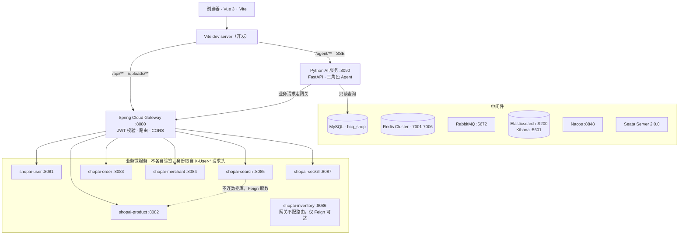

# ShopAi · 分布式电商平台

一个从单体逐步拆分为 8 个 Spring Cloud 微服务的电商系统，覆盖用户、商品、订单、商家、库存、搜索、秒杀七个业务域，另含一个基于大模型的多角色 Agent 服务（FastAPI + SSE 流式对话）。

> 本项目为**个人学习项目**，从需求、编码、拆分微服务到部署脚本均由作者独立完成，非企业生产项目。

| | |
|---|---|
| 后端 | Java 21 · Spring Boot 3.2.4 · Spring Cloud 2023.0.1 · Spring Cloud Alibaba 2023.0.1.0 |
| 前端 | Vue 3 · Vue Router · Axios · Vite |
| AI 服务 | Python · FastAPI · OpenAI 兼容接口（DeepSeek）· SSE |
| 中间件 | MySQL 8 · Redis Cluster · RabbitMQ · Elasticsearch 8.11 · Nacos 2.3.2 · Seata 2.0.0 · Sentinel 1.8.8 |
| 构建 | Maven Wrapper（`./mvnw`）· Docker Compose |

---

## 1. 功能概览

| 端 | 能力 |
|---|---|
| 买家 | 注册登录、商品分类浏览、商品搜索与筛选、购物车、地址管理、下单、订单状态流转、退款、评价、秒杀抢购 |
| 商家 | 入驻申请、店铺与实名信息修改（需审核）、商品与 SKU 管理、订单发货、财务与提现、周营收统计、评价投诉 |
| 管理端 | 用户管理、商家入驻/修改审核、提现审核、平台仪表盘 |
| AI 助手 | 客服 / 商家 / 管理三种角色的 Agent，按角色挂载不同工具集，SSE 流式返回 |

---

## 2. 系统架构

### 2.1 部署拓扑



> 上面是 Mermaid 源码，GitHub 会直接渲染成图。若你的预览器不支持，看 2.2 / 3 两节即可。

### 2.2 服务间调用

服务之间一律 Feign 直连（`lb://` + Nacos 服务发现），每个客户端都有对应 Fallback：

| 调用方 | 被调方 |
|---|---|
| `shopai-order` | user、inventory、merchant、product、search、seckill |
| `shopai-product` | inventory、merchant、search |
| `shopai-seckill` | user、merchant、order、product |
| `shopai-search` | product、merchant（评价由 merchant 承载）、order、user |
| `shopai-merchant` | user、order、product、search |
| `shopai-user` | merchant、order、product、search |
| `shopai-inventory` | 无，纯被调方 |

### 2.3 消息与索引同步

- 数据变更事件走 `shopai.data.exchange`，routing key 成对出现：`product.changed` / `product.changed.delete`、`merchant.*`、`order.*`、`review.*`、`user.*`，分别投递到 `shopai.search.*.changed.queue`，由 `shopai-search` 消费写入 ES。
- 秒杀下单走 `seckill.order.create` → `shopai.seckill.order.create.queue`，由 `shopai-order` 消费建单。
- 统一死信：`shopai.dlx.exchange` / `shopai.dlx.queue`。

**一条请求的走向**：浏览器 →Vite → 网关（JWT 校验，注入 `X-User-Id` / `X-User-Role`）→ 业务服务（从请求头取身份，不再各自验签）→ Feign/MQ 与其他服务协作 → 落库；索引类数据在事务提交后经 MQ 异步同步到 Elasticsearch。Python AI 服务不绕过网关，业务请求同样走 `/api/**`。

---

## 3. 服务划分

| 服务 | 端口 | 职责 | 网关路由 |
|---|---|---|---|
| `shopai-gateway` | 8080 | 统一入口、JWT 认证、路由转发、全局 CORS | — |
| `shopai-user` | 8081 | 登录/注册、客户资料、管理员用户管理、仪表盘、静态图片 `/uploads/**` | `/api/auth/**`、`/api/customer/**`、`/api/admin/users\|customers\|dashboard`、`/api/common/**`、`/uploads/**` |
| `shopai-product` | 8082 | 商品、分类、SKU 基本信息、热销榜 | `/api/product/**`、`/api/category/**`、`/api/sku/**` |
| `shopai-order` | 8083 | 购物车、地址、订单状态机、退款、自动收货定时任务 | `/api/order/**`、`/api/cart/**`、`/api/address/**` |
| `shopai-merchant` | 8084 | 商家入驻与审核、店铺/实名修改审核、提现与财务、评价与投诉 | `/api/merchant/**`、`/api/admin/merchants/**`、`/api/review/**` |
| `shopai-search` | 8085 | 商品/商家/订单/评价/用户的 ES 索引与查询、列表分页、聚合筛选、MQ 增量同步、全量重建 | `/api/search/**` |
| `shopai-inventory` | 8086 | 库存查询、扣减、回补、秒杀扣减、库存预热 | **不对外暴露**，仅 Feign 直连 |
| `shopai-seckill` | 8087 | 秒杀活动管理、独立秒杀库存、Redis 预热 + Lua 原子扣减、MQ 异步下单、一人一单 | `/api/seckill/**` |
| `shopai-common` | — | 公共模块：统一响应体、分页、全局异常、JWT 工具、Redis 封装、MQ 事件与常量、Feign 内部 DTO、事务后置执行器 | — |

---

## 4. 设计要点

### 4.1 网关统一认证，内部接口对外不可达

- 各业务服务**不各自验签 JWT**，网关 `JwtAuthGlobalFilter` 统一校验后把身份写进 `X-User-Id` / `X-User-Role` 请求头，服务内用 `CurrentUser` 读取。
- 服务间内部接口统一走 `/api/{域}/internal/**`，网关在**业务通配路由之前**用 `uri: no://op` 命中即 503，把它们挡在公网之外。
  - 这样做的原因：`/api/merchant/**` 这类通配路由会顺带把 `/api/merchant/internal/**` 暴露出去，等于任何人都能直接调内部接口。
  - 秒杀服务的 `/api/seckill/internal/**`（订单服务回调落账）同理——若暴露，任何人都能伪造「订单已创建」把抢购记录改成成功。
- 库存服务干脆**不配路由**，网关默认 404，只有 Feign 能访问。

### 4.2 列表查询下沉到搜索服务

列表页（分页、排序、分类聚合）原本是各服务直接查 MySQL 的 `count + limit`，数据量上来后主库压力大。改造后由 `shopai-search` 承接列表查询，走 ES 的 `from/size` 与聚合，源数据通过 Feign 从商品/商家服务的内部接口拉取，**搜索服务本身不连数据库**。

### 4.3 秒杀：Redis + Lua + MQ + 本地消息表

1. 活动开始前把秒杀库存预热进 Redis。
2. 抢购请求用 **Lua 脚本原子完成**「校验一人一单 + 扣减库存」，避免先 GET 再 DECR 之间被并发插入。
3. 扣减成功后发 MQ 消息异步创建订单，接口立即返回排队结果，前端轮询 `/result/**`。
4. 生产端用**本地消息表**保证「扣减了库存就一定会有订单」：消息与业务写在同一事务，定时任务补偿未确认的消息。
5. 秒杀库存**完全独立**，不与 `shopai-inventory` 的 `inventory` 表联动；商品/SKU 信息不落库，实时 Feign 调用商品服务。

### 4.4 下单与退款：Seata AT

下单时通过 Feign 调库存服务扣减、退款时回补，跨服务写操作用 Seata AT（`undo_log`）保证一致性；销量累计则通过 Feign 调商品服务的内部接口完成。

### 4.5 索引同步：事务提交后才发消息

商品、商家等数据变更后需要同步 ES。事件发布统一走 `AfterCommitExecutor`——**只有数据库事务真正提交后**才发 MQ，避免出现「消息已发、事务回滚」导致索引脏数据。消费端 `IndexEventConsumer` 增量写入，另有全量重建入口。

### 4.6 其他

- **Long 主键序列化为 String**：`LongToStringResponseAdvice` 全局把 `Long` 输出成字符串，避免 JS `Number.MAX_SAFE_INTEGER` 精度丢失导致前端 ID 变样。
- **Feign + Sentinel fallback**：每个 Feign 客户端都有对应 Fallback，下游不可用时返回明确的降级原因（`FeignFallbackReason`），而不是抛 500。
- **定时任务**：订单超时关闭、自动收货完成等由 `SchedulerConfig` 统一调度。

---

## 5. 目录结构

```
ShopAi/
├── JAVA/                         # 后端多模块 Maven 工程
│   ├── pom.xml                   # 父 POM（版本统一管理）
│   ├── mvnw / mvnw.cmd           # Maven Wrapper，无需预装 Maven
│   ├── shopai-common/            # 公共模块
│   │   └── src/main/java/com/shopai/common/
│   │       ├── advice/           # Long → String 响应增强
│   │       ├── config/           # MyBatis-Plus / Redis / Rabbit / Security / WebMvc / 调度
│   │       ├── dto/internal/     # 服务间 Feign 传输对象
│   │       ├── mq/               # IndexChangedEvent / IndexEventPublisher / MqConstants
│   │       ├── redis/RedisService
│   │       ├── security/         # JwtUtil / CurrentUser
│   │       └── tx/AfterCommitExecutor
│   ├── shopai-gateway/
│   ├── shopai-user/
│   ├── shopai-product/
│   ├── shopai-order/
│   ├── shopai-merchant/
│   ├── shopai-search/
│   ├── shopai-seckill/
│   ├── shopai-inventory/
│   ├── sql/                      # 建表与初始化脚本
│   └── docs/sql/                 # 增量修复脚本（余额、退款序号、秒杀等）
├── Vue/                          # 前端（Vite 开发端口 5173，代理 /api /uploads → 8080，/agent → 8090）
├── Python/                       # AI 服务（FastAPI :8090）
│   ├── agents/                   # admin / merchant / customer 三种角色 Agent
│   ├── core/                     # 鉴权、数据库连接池、LLM 客户端
│   ├── routers/chat.py           # SSE 对话接口
│   ├── services/java_api.py      # 调用 Java 内部接口的封装
│   └── tools/                    # 各角色可调用的工具函数
├── ShopRedis/                    # Redis Cluster 6 节点（7001-7006）docker-compose
├── deploy/                       # 部署文档 + Nginx 配置（留的后续用的）
├── docker-compose.yml            # Elasticsearch / Kibana / Sentinel Dashboard
└── 数据库表结构.txt               # 14 张表的 DDL
```

---

## 6. 快速开始

### 6.1 前置依赖

| 组件 | 版本 | 说明 |
|---|---|---|
| JDK | 21 | 微服务以 Java 21 构建 |
| MySQL | 8.x | 库名 `hcq_shop` |
| Redis | 6/7.x | 需 **Cluster** 模式（6 主从节点，见 `ShopRedis/`） |
| RabbitMQ | 3.x | 默认 5672，guest/guest |
| Elasticsearch | 8.11.x + IK 8.11.x | 7.x 分词器不兼容 |
| Nacos | 2.3.2 | 与 SCA 2023.0.1.0 客户端对齐，不要用 3.0 |
| Seata Server | 2.0.0 | 需在业务库建 `undo_log` 表 |
| Node.js | 18+ | 前端构建 |

### 6.2 启动中间件

```bash
# Elasticsearch 8.11.1 + Kibana 5601 + Sentinel Dashboard 8858
docker network create shopai      # compose 里网络为 external
docker compose up -d

# Redis Cluster（6 节点 7001-7006）
cd ShopRedis && docker compose up -d
```

Nacos、Seata Server、RabbitMQ 按需本地启动（Nacos 2.3.2、Seata 2.0.0）。

### 6.3 初始化数据库

在 MySQL 中创建 `hcq_shop` 库，导入 `数据库表结构.txt`（14 张表）与 `JAVA/sql/` 下的初始化脚本；秒杀相关表见 `JAVA/docs/sql/seckill.sql`。

### 6.4 填写配置

各服务 `src/main/resources/application.yml` 中以下项**需要按你的环境填写**：

```yaml
spring:
  datasource:
    username: <你的 MySQL 用户>
    password: <你的 MySQL 密码>
  data:
    redis:
      cluster:
        nodes:            # 填 6 个节点，如 127.0.0.1:7001 ...
```

Nacos（8848）、Sentinel（8858）、RabbitMQ（5672）、ES（9200）、MySQL（3306）默认都指向 `127.0.0.1`，与上表一致。

> 本地没有 Nacos / Seata Server 时，可注释掉 `cloud.nacos`、`config.import` 与 `seata` 段，并把网关路由的 `lb://shopai-xxx` 改成 `http://localhost:端口` 直连调试。

### 6.5 启动后端

```bash
cd JAVA
./mvnw clean package -DskipTests        # Windows: .\mvnw.cmd clean package -DskipTests

# 建议启动顺序：user → product → order → merchant → inventory → search → seckill → gateway
java -jar shopai-user/target/shopai-user-1.0.0-SNAPSHOT.jar
# ... 其余服务同理
```

### 6.6 启动前端

```bash
cd Vue
npm install
npm run dev      # http://localhost:5173
```

### 6.7 启动 AI 服务

```bash
cd Python
pip install -r requirements.txt
# 在 .env 中配置 OPENAI_API_KEY / OPENAI_BASE_URL（OpenAI 兼容接口，如 DeepSeek）
python main.py   # http://localhost:8090
```

---

## 7. 已知限制

- 8 个服务**共享同一个 MySQL 库** `hcq_shop`，尚未做垂直分库，属于「逻辑拆分、物理同库」阶段。
- 自动化测试覆盖不足，目前只有手工验证用例，没有集成测试。
- 秒杀链路依赖 Redis Cluster，本地只起单机 Redis 时相关功能不可用。
- 未接入真实支付渠道，订单与退款为模拟状态流转。

---

## 8. 关于本项目

个人独立完成的练手项目，目标是把「单体 → 微服务」的拆分过程完整走一遍：服务边界怎么切、跨服务一致性怎么保证、缓存与消息如何配合、索引与主库怎么同步、网关如何收敛鉴权与路由。

- 部署说明见 [`deploy/README.md`](deploy/README.md)
- 作者：HCQ · 2026 届 · Java 后端方向
